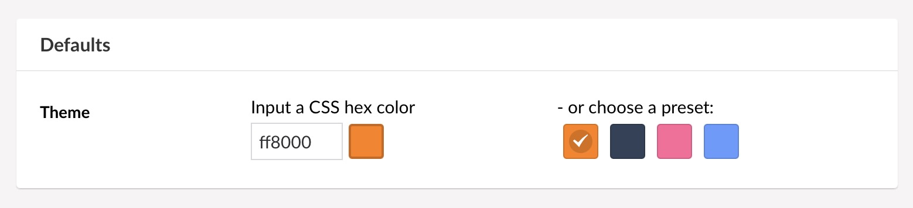
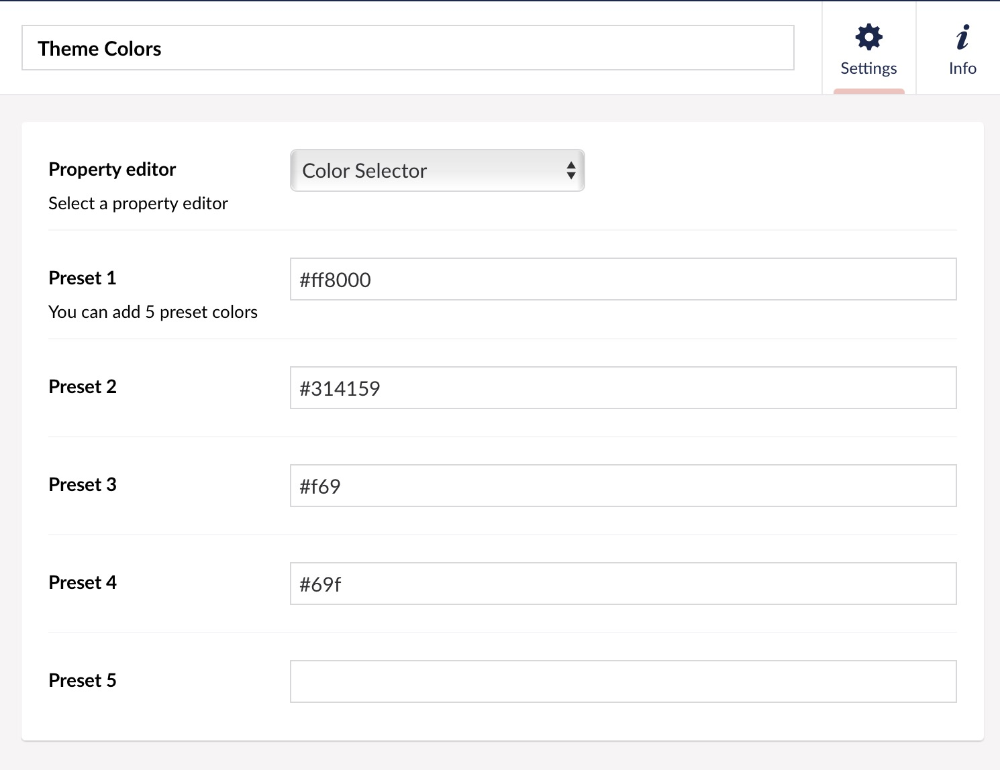

# Color Selector for Umbraco

A Property Editor for selecting a color - either by picking from a few defaults
or by providing a specific CSS color value.

Currently allows for 5 presets (per datatype).

## Versions

- Version 1.x (Umbraco package) works in Umbraco 7 and Umbraco 8
- Version 3.x (Nuget package) works in Umbraco 10, Umbraco 11 and Umbraco 13
- Version 6.x (Nuget package) works in Umbraco 16

It might work in other versions but I haven't been able to test as I don't really understand .net targeting/versioning

Note that you'll need to manually download the appropriate _PropertyValueConverter_
for version 1.x, depending on which Umbraco version you have.

The Nuget package for v3.x installs a PropertyValueConverter automatically.

> [!NOTE]
> The v6.x version currently doesn't install a PropertyValueConverter as it's not really needed.

## Changes

From version 6 a toggle is included to disable the manual input, although it makes it work
somewhat identically to the built-in **Color Picker** property editor. It's just easier to turn it off
than to switch to a whole new editor if/when the need arises.

## Screenshots

### Property editor

### Configuration

